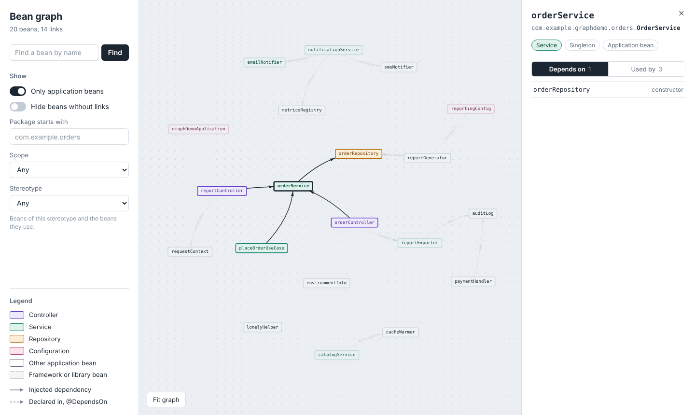

# Bean Graph Visualizer



## Installation

### From JitPack

Gradle (Kotlin DSL):

```kotlin
repositories {
    mavenCentral()
    maven("https://jitpack.io")
}

dependencies {
    implementation("com.github.Artyomlbch:bean-graph-visualizer-spring-boot-starter:v2.0.0")
}
```

Maven:

```xml
<repositories>
    <repository>
        <id>jitpack.io</id>
        <url>https://jitpack.io</url>
    </repository>
</repositories>

<dependencies>
    <dependency>
        <groupId>com.github.Artyomlbch</groupId>
        <artifactId>bean-graph-visualizer-spring-boot-starter</artifactId>
        <version>v2.0.0</version>
    </dependency>
</dependencies>
```

### From source

```shell
git clone https://github.com/Artyomlbch/bean-graph-visualizer-spring-boot-starter.git
cd bean-graph-visualizer-spring-boot-starter
./gradlew publishToMavenLocal
```

Then add the local Maven repository to your application:

```kotlin
repositories {
    mavenCentral()
    mavenLocal()
}

dependencies {
    implementation("org.artyomlbch:bean-graph-visualizer-spring-boot-starter:2.0.0")
}
```